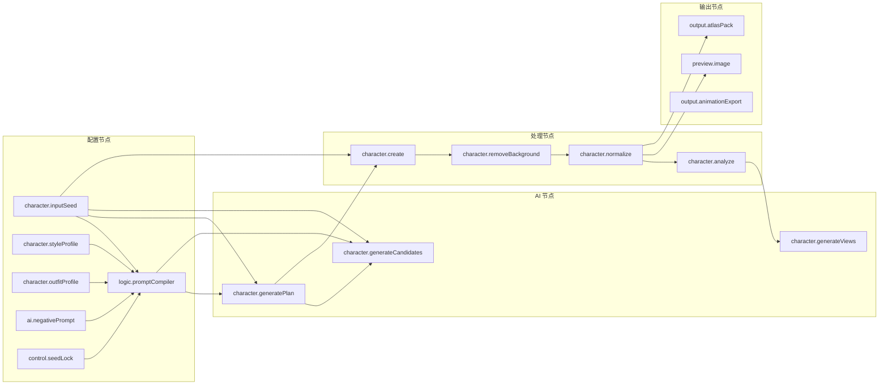

# 角色生成流水线（节点工作流视角）

本文档描述 JMTools **节点工作台**中的角色生成全流程：从专业 2D 游戏资产 AI 产线阶段，映射到 `character.*` 节点 kind、端口 asset 与项目落盘约定。

**范围**：节点工作流 + **角色工坊 UI**（创建工作室 / 生产工作室）。二者共享 Rust 产线与 `assets/characters/` 数据。

角色工坊 UI 映射见本文 [第 6 节](#6-角色工坊-ui-映射)。

相关实现：

- 节点描述符：[`shared/workflow-nodes/nodes.json`](../shared/workflow-nodes/nodes.json)
- 执行器：[`src-tauri/src/engine/executor/character_nodes.rs`](../src-tauri/src/engine/executor/character_nodes.rs)
- 标准模板：`character-full-pipeline`（[`workflowTemplates.ts`](../src/features/workflows/workflowTemplates.ts) 首位）
- 落盘演进：[`character-pipeline-roadmap.md`](character-pipeline-roadmap.md)

---

## 1. 专业流水线 → 节点映射

行业标准 2D 角色 AI 产线（Concept → Creation → Processing → Views → Export）在 JMTools 中由 **character 域节点** 承担：



| 专业阶段 | 节点 kind | 输入 / 输出（端口） | 落盘路径 |
|----------|-----------|---------------------|----------|
| 角色种子 | `character.inputSeed` | → `asset`（characterSeed） | — |
| 风格配置 | `character.styleProfile` | → `asset`（styleProfile） | — |
| 装备外观 | `character.outfitProfile` | → `asset`（outfitProfile） | — |
| 负向提示 | `ai.negativePrompt` | → `asset`（promptText） | — |
| Prompt 编译 | `logic.promptCompiler` | seed + profiles + control → `asset`（promptBundle） | — |
| 控制层 | `control.*` | → `asset`（controlProfile） | — |
| 母版方案 | `character.generatePlan` | characterSeed + promptBundle → `asset`（masterPlan） | — |
| 候选图 | `character.generateCandidates` | masterPlan + promptBundle → `asset`（candidateImages） | `.cache/` + create 时 `raw/` |
| 入库 | `character.create` | masterPlan + candidateImages → `character` | `character.json` + `master/` + `raw/` |
| 去背景 | `character.removeBackground` | character → character | `processed/*_transparent.png` |
| 规范化 | `character.normalize` | character → character + `image` | `processed/*_normalized.png` |
| 图像预检 | `character.analyze` | character → character | `processing` 元数据 |
| 多视图 | `character.generateViews` | character → character | `views/` |
| 动作帧 | `character.generateActionFrames` | character → character | `animations/<action>/<viewKind>/`（`actionIds` 多选动作 × 全部视图） |
| 动作序列预览 | `preview.actionSequence` | character → character | 画布内帧条预览（透传角色） |
| 静态图预览 | `preview.image` | image / character → image | 工作台内单图预览 |
| 图集打包 | `output.atlasPack` | image → `asset` | `exports/` |
| 动画导出 | `output.animationExport` | frames → `asset` | `exports/` |
| Godot 导出 | `output.godotSpriteFrames` | frames → `asset` | `exports/workflows/godot/*.tres` |

说明：

- `character-full-pipeline` 模板已以 **`logic.promptCompiler`** 为 AI 链入口；`logic.promptMerge` 仍保留供简单拼接场景。
- 节点间传递的是 **workflow asset**（JSON 包装），不是 React 组件状态。
- 架构总览见 [`game-asset-compiler-architecture.md`](game-asset-compiler-architecture.md)。

### promptCompiler 与 generatePlan 的区别

| 节点 | 是否调用 AI | 输出 | 用途 |
|------|-------------|------|------|
| `logic.promptCompiler` | 否 | `promptBundle`（正向/负向 prompt + AST） | 本地规则合并 seed、风格、装备、负向词 |
| `character.generatePlan` | 是（文本模型） | `masterPlan` JSON | 生成角色定位、`pixelPrompt`、候选方案元数据与动作建议 |

`generatePlan` **不是**简单的 Prompt 润色，而是为后续 `generateCandidates` 提供结构化方案。

### 为何 create 在 removeBackground 之前

行业标准顺序为：**候选图 → 入库（create）→ 去背景 → 规范化 → QC**。`removeBackground` / `normalize` 更新的是已写入 `assets/characters/<id>/` 的角色视图记录；若将 create 移到去背景之后，需要临时角色或重构写盘模型，当前架构不支持。

### 画布预览覆盖范围

凡产生或更新图像的节点，运行成功后应在**画布节点卡片**与**检查器输出 Tab**显示预览：

- `generateCandidates`：候选图（多图）
- `create`：母版/原始视图
- `removeBackground`：透明背景图
- `normalize`：规范化图
- `generateViews`：各方向视图（节点卡片优先读 `normalizedImage` / `transparentImage`，否则 fallback 到 `rawImage`）
- `generateActionFrames`：仅负责动作帧生成与写盘；节点卡片显示参数摘要，**不做**序列条预览
- `preview.actionSequence`：动作帧序列条 + 方向切换；从上游 `character` 透传输出，供导出/特效节点复用

`character.analyze` 不修改图像，预览显示被 QC 的规范化/透明图；QC 结果在 `processing` 元数据中。

---

## 2. 标准运行顺序

推荐加载模板 **「角色完整生产线」**（`character-full-pipeline`），按以下顺序操作：

1. **配置**：填写 `inputSeed` / `styleProfile` / `outfitProfile`；在 **设置 → 模型用途绑定** 分别配置「角色生成（文生图）」与「角色图像编辑（img2img）」模型（详见 §5.2；节点内可覆盖）。
2. **生成方案**：运行至 `character.generatePlan`，在检查器 **方案** Tab 确认 masterPlan 摘要。
3. **生成候选**：运行 `character.generateCandidates`（依赖 plan + seed）。
4. **入库**：运行 `character.create`（模板已连线 `candidateImages`）；在检查器点选候选图或留空自动推荐。
5. **后处理（新顺序）**：先 `generateViews` 生成全部方向，再依次 `removeBackground` → `normalize` → `analyze` → `generateActionFrames`。
   - `removeBackground` / `normalize` 在 `viewId` 留空时会**遍历所有视图**，保证四方向都去背景、规范化；动作帧从规范化透明图复制，因此**动作帧也自动透明**。
6. **预览与导出**：`preview.actionSequence` 从 `generateActionFrames` 接入角色输出以检查动作帧；`output.atlasPack` / `output.animationExport` 同样依赖动作帧完成后再执行。

局部运行：每个 character 域节点均可单独运行（helpText 已注明前置条件）。重跑上游节点时会自动使下游节点失效并重新执行。

---

## 3. 节点域原则

| 原则 | 说明 |
|------|------|
| 配置在节点 | 角色名称、风格、provider 等均在节点 `params` 或上游 asset，不在独立表单页 |
| Prompt 不硬编码 | 合并逻辑在 `logic.promptMerge` 与 profile 节点；禁止在 Workbench 组件写长 Prompt |
| AI 只产 asset | `generatePlan` / `generateCandidates` 输出 asset；写盘由 Rust 命令完成 |
| 处理写回 character | `removeBackground` / `normalize` / `generateViews` 更新项目角色记录 |
| 预览在流内 | 静态图用 `preview.image`；动作序列用 `preview.actionSequence`；运行面板亦可查看输出 |
| 可重跑 | 工作流 definition 可保存后重复执行；节点输出受 engine cache key 约束 |

---

## 4. 项目目录约定

目标结构（详见 [`character-pipeline-roadmap.md`](character-pipeline-roadmap.md)）：

```text
assets/characters/<character_id>/
├─ character.json          ← character.create
├─ config/generation.json  ← 规划：可重放配置
├─ raw/                    ← generateCandidates
├─ processed/              ← removeBackground、normalize
├─ views/                  ← generateViews
├─ animations/<action>/<viewKind>/  ← generateActionFrames（默认全部已有视图）
└─ exports/                ← atlasPack、animationExport
```

当前阶段：`character.json` 与部分 processed/views 路径已由 Rust 命令写入；`config/`、`animations/` 完整分层仍在 roadmap 中。

---

## 5. 质量门禁（节点可实现）

| 检查点 | 节点 / 行为 |
|--------|-------------|
| 方案可解析 | `generatePlan` 输出须为合法 masterPlan JSON |
| 去背景 | 默认 `engine=chroma`；`rembg` 可选，注意商用授权 |
| 画布尺寸 | `normalize` 的 `targetWidth` / `targetHeight` 与项目规格一致 |
| 多视图 | `generateViews` 补全缺失方向；默认 **三视图+镜像** 策略减少 API 调用；以正面定妆图作图像参考保证同角色一致 |

---

## 5.1 多视图生成成本策略

`character.generateViews` 支持 `generationStrategy` 参数：

| 策略 | 四向 API 次数 | 八向 API 次数 | 说明 |
|------|--------------|--------------|------|
| **threeViewMirror**（默认） | 2 | 4 | API 生成 `back`/`right`（四向）或再加 `frontRight`/`backLeft`（八向）；`left`/`frontLeft`/`backRight` 本地水平镜像 |
| **perView** | 3 | 7 | 每个缺失方向独立 prompt 调 API（front/single 仍复用母版） |
| **turnaroundGrid** | 1 | 1（+ 对角镜像/补生成） | 以母版为参考一次生成 2×2 四朝向 sheet，再 `split_turnaround_sheet` 切为 `back`/`left`/`right` 填入 raw_image；同一次生成天然一致 |

**一致性控制（已实现）**

- `generateViews` 取正面（front/single）的**透明定妆图作为图像参考**（img2img 条件化）：
  - Qwen 走 `multimodal-generation` 的 `content` 数组传 `{ "image": dataUrl }`，并对视图生成关闭 `prompt_extend`、附加稳定 `seed`，降低跨调用漂移。
  - `referenceStrength` 参数（仅 Qwen 生效）控制对参考图的依赖强度，作为 `strength` 写入 parameters。
  - 不支持图像参考的 OpenAI 风格服务商会**回退纯文生图**。
- 视图 prompt 强约束“与参考图保持同一角色/配色/装备，仅改变朝向”。
- **回退/一致性提示已可见**：每个视图把实际条件化方式（已用参考图 / 回退文生图 / 缺参考图）写入 `views[].quality.warnings`，前端视图槽以 ⚠ 标记并在 tooltip 展示，生成完成后汇总进状态消息。

**生成尺寸（已实现）**

- `resolve_image_model` 现按 `(provider_id, model_name)` 读取 `ai_provider_models.default_width/height`（不再恒为 1024）。
- `resolve_api_generation_size` 以目标画布的整数倍请求生成（较长边接近但不超过 1024），减少后续大比例降采样导致的模糊。

**后续可选（roadmap）**

- **ControlNet / OpenPose**：以骨架约束朝向与姿态（需先接入 ComfyUI/SD-WebUI 本地 provider）。
- 配套成本控制：运行前预估 API 次数、低清草稿确认后再高清、workflow cache 复用未 dirty 视图。
- **单视图重跑**：`removeBackground` / `normalize` 支持指定 `viewId` 仅处理单个方向；重生成单个视图可在 `generateViews` 用 `views` 参数限定子集。

---

## 5.2 文生图 / 图像编辑 双模型绑定（已实现）

部分服务商（如 Qwen / DashScope）把**文生图**与**图像编辑(image-edit / img2img)**拆成不同模型：

- 图像编辑模型走 `multimodal-generation`，**必须带 1~3 张参考图**；用它跑候选图/母版这类纯文生图步骤会被服务端拒绝（`HTTP 400`）。
- 文生图模型不接受参考图。

因此设置中提供两个角色绑定：

| 绑定字段 | 设置项 | 用于 | 调用点 |
|----------|--------|------|--------|
| `aiCharacterModel` / `aiCharacterProviderId` | 角色生成（文生图） | 候选图、母版、工作流通用生图 | `generateCandidates` / master / workflow image |
| `aiCharacterEditModel` / `aiCharacterEditProviderId` | 角色图像编辑（img2img） | 带正面参考图的视图 / turnaround / 动作帧 | `generateViews` / `generate_turnaround_views` / `generateActionFrames` |

- 编辑绑定**留空时自动回退**到角色生成绑定，单模型用户无感。
- 模型库按名称启发式识别 `image-edit` 类型（名字含 `edit`/`imageedit` 等），下拉中「角色图像编辑」可同时选 image / image-edit 模型。
- 兜底保护：当文生图链路（无参考图）误用了编辑类模型时，`request_qwen_image_url_inner` 直接返回中文报错，提示改绑文生图模型，而不是抛出底层 400。

---

## 5.3 人工节点（control.manualGate，已实现）

用于「方案选择 / 入库确认」等需要人工判断的环节：执行到该节点时**暂停**整个 run，前端弹出候选项供用户选择，确认后从下游继续。

- 参数：`prompt`（提示语）、`options`（逗号分隔候选项）、`allowMultiple`（是否多选）。输入/输出端口为 `character` 透传，并在输出附带 `manualSelection` 与 `summary`。
- 暂停机制：运行循环遇到 `control.manualGate` 且无决策时，把剩余拓扑队列、已产出 outputs、节点状态写入 `workflow_run_checkpoints` 断点表，run 状态置为 `awaiting_input`，发出 `workflow://node_input_required` 事件，**不**结束运行。
- 恢复：`resume_workflow_run({ runId, nodeId, decision })` 读回断点、把用户选择注入该节点输出后从下一节点继续；可**关闭应用后重开再恢复**（断点已落库）。
- 取消：等待期间 `cancel_workflow_run` 会清理断点并把 run 标记为 `canceled`。

### 5.4 工作台体验与后续路线图（2026-06）

**已修复（本次）**

- **项目隔离**：切换 `project.rootPath` 时重置 `workflowStore` 会话态，并按项目 `localStorage` 恢复上次打开的工作流，避免项目 A/B 共享同一画布与运行态。
- **载入体验**：画布首屏立即渲染空白/缓存工作流；工作流列表异步同步且延迟 300ms 才显示 loading 提示。
- **节点完成即预览**：节点 `rawStatus=succeeded` 即显示预览，不再被 `waiting_upstream` 门禁；运行中 `nodeRuns` 更新不受画布拖拽阻塞。
- **候选数量对齐**：`candidateCount`（1–4）在 `generatePlan` prompt、`ensure_candidate_plans` 补齐与 `generateCandidates` 循环中一致生效。

**下一阶段（P2 规划）**

1. **人工节点 × 创建角色联动**：在 `character.create` 前插入 `control.manualGate`，候选项来自上游 `candidateImages`；用户选择写入 `selectedPlanId` 后 `resumeWorkflowRun` 续跑。
2. **重开恢复 awaiting_input**：进入工作台时查询 DB 中 `status=awaiting_input` 的 run + checkpoint，自动弹出 [`WorkflowManualGateDialog`](../src/features/workflows/WorkflowManualGateDialog.tsx)。
3. **运行历史与项目绑定**：`selectedRun` 必须属于当前 `projectRoot + workflowId`；切换工作流时清空不属于当前链路的 run 预览。
4. **生成质量链路**：四方向/三视图 turnaround 一致性（edit 模型 + `referenceStrength`）；跨视图 QC 节点（尺寸/透明边/色板检查）。
5. **性能与可观测**：长 run 节点级 progress/ETA；大图预览 lazy + 缩略图缓存，避免 Pixi/DOM 同时解码阻塞主线程。

---

## 6. 工作流模板关系

| 模板 ID | 定位 |
|---------|------|
| **`character-full-pipeline`** | **标准全链路（canonical）** |
| `character-node-pipeline` | 上游：seed → merge → ai 生图演示 |
| `character-master-postprocess` | 下游：已有角色 load + 去背景 + bind |
| `ai-character-production` | 通用 AI 链，非 character 域专用 |
| `image-background-removal` | 单图去背景，与角色域无关 |

---

## 7. 已知缺口（节点域）

以下能力仍在 roadmap 中：

- Godot SpriteFrames 完整资源（当前 `.tres` 为初版骨架）
- `character.load` 仅用于后处理模板，不在 full-pipeline 主链
- 跨视图一致性自动 QC（朝向/对称性比对）尚未实现
- 工作台重开自动恢复 `awaiting_input` run（断点已落库，UI 恢复待接）
- 人工节点与 `character.create` 的 `selectedPlanId` 端到端联动（gate 节点已有，模板串联待完善）

已补齐：`generateActionFrames` 已从占位复制升级为**逐帧 img2img 真实 AI 生成**（参考源图 + 逐帧 prompt + 派生 seed + Qwen 限速）；需绑定支持图像参考的服务商（如 Qwen）。`generatePlan` / `generateCandidates` 的 `candidateCount` 现已与候选方案数对齐。

扩展新节点时：先改 `nodes.json` → `character_nodes.rs` → 必要时 `commands/characters.rs` 工作流辅助函数。编码约束见 [`.cursor/rules/character-pipeline.mdc`](../.cursor/rules/character-pipeline.mdc)。

---

## 8. 对标调研与分阶段优化 roadmap

对照业界较知名的 AI 2D 游戏素材方案，梳理本管线的差距与优先级。

### 对标参考

| 方向 | 业界做法（Scenario.gg / Retro Diffusion / PixelLab / SD 生态） | 对本项目的启示 |
|------|---------------------------------------------------------------|----------------|
| 多视图一致性 | img2img + 参考图 / IP-Adapter / Reference-Only / 角色 turnaround LoRA；ControlNet OpenPose 约束朝向 | 已落地“正面定妆图作参考 + 稳定 seed + referenceStrength”，并新增 turnaround 单图拆分策略；真 ControlNet 需先接本地 provider |
| 像素清晰度 | 生成即目标分辨率，或整数倍缩放 + 调色板量化，避免后期大比例降采样 | 已加 `scaleMode=integer`、`resolve_api_generation_size`（按目标整数倍生成）与 `paletteSize` 调色板量化 |
| 去背景 | 像素风用硬 alpha 阈值、低/零羽化，避免半透明软边 | 模板已将 `edgeSoftness` 降到 6；可进一步加“硬边/调色板对齐”预设 |
| 动作动画 | 关键帧 + 插值，或 pose 序列驱动 img2img 逐帧生成 | 已落地逐帧 img2img 真实 AI 生成（参考源图 + 逐帧 prompt + 派生 seed） |
| 质量门禁 | 自动 QC（覆盖率、bbox、对称性）+ 人审 | `analyze` 已输出覆盖率/bbox/脚线并写告警与摘要；可扩展跨视图一致性 QC |

### 分阶段优先级

| 优先级 | 项目 | 状态 |
|--------|------|------|
| **P0** | 四视图一致性（母版图像参考 + seed）；去背景/规范化作用于全部视图（动作帧自动透明） | 已实现 |
| **P1** | 消除降采样模糊（`scaleMode` 整数倍 / 仅居中）；`analyze` 暴露 QC；动作帧参数化（动作集/帧率/循环） | 已实现 |
| **P2** | AI 生成尺寸对齐目标分辨率（`resolve_api_generation_size`）；调色板量化（`paletteSize`）；turnaround 朝向约束；真实 AI 逐帧动作；回退提示可见化 | 已实现 |
| **P3** | ControlNet/OpenPose 朝向约束（需 ComfyUI/SD-WebUI 本地 provider）；跨视图一致性自动 QC；真实 AI 动作的姿态序列驱动 | 规划中 |

---

## 6. 角色工坊 UI 映射

角色工坊与节点工作台共享 Rust 产线（`src/lib/tauri/characterPipeline.ts` → `character_pipeline` / `characters` 命令），UI 按 **引导式创建** + **高级生产 Tab** 组织。

| 工坊区块 | 向导步 / Tab | 对应节点 kind | 前端入口 |
|----------|--------------|---------------|----------|
| 概念 | 创建 · 概念（五 Tab 设定工作台） | `character.inputSeed` / `styleProfile` / `outfitProfile` | `ConceptSetupStep`（模板/身份/风格/外观/生成） |
| 方案 | 创建 · 方案（只读摘要 + Prompt） | `logic.promptCompiler` + `character.generatePlan` | `PlanReviewStep` + `draftToPromptInputs` |
| 候选 | 创建 · 候选 | `generateCandidates` + `manualGate` | `CharacterPlanPreview`（无 fixture 占位） |
| 入库 | 创建 · 确认 | `character.create` | `ConfirmStep` |
| 快捷后处理 | 创建 · 可选 | `generateViews` / `removeBackground` / `normalize` / `analyze` | `PostProcessStep` |
| 概览 | 生产 · 概览 | QC 摘要 | `ProductionStudioShell` · overview |
| 视图 | 生产 · 视图 | `character.generateViews` | `generateViews()` + `ParamFieldRenderer` |
| 处理 | 生产 · 处理 | `removeBackground` / `normalize` / `analyze` | 角色域 API（非 `runAssetTool`） |
| 动作 | 生产 · 动作 | `character.generateActionFrames` | `generateActionFrames()` |
| 导出 | 生产 · 导出 | `animationExport` / `godotSpriteFrames` | `export_character_animation` |

**双向桥接**：

- 工坊 → 工作流：工具栏「在工作流中打开」→ `workflowOpenIntent` 载入 `character-full-pipeline` 并预填 `character.load`
- 工作流 → 工坊：检视器「在角色工坊中编辑」→ `characterWorkshopIntent` 打开生产 Tab 并定位阶段

**状态**：`characterWorkshopStore`（模式/向导步/Tab）+ TanStack Query（`useCharacterList` / `useCharacterRecord`）。

