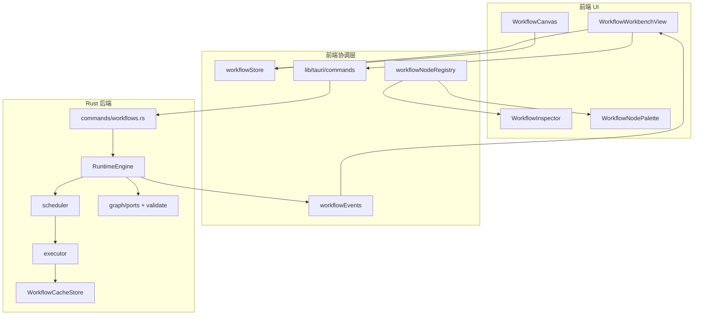

# 工作流引擎架构

本文档描述 JMTools 节点工作流（Workflow）的前后端分层、描述符约定、事件协议与缓存语义。实现位于 `src/features/workflows/`（前端）与 `src-tauri/src/engine/`（Rust 运行时）。

## 分层概览



| 层 | 职责 |
|----|------|
| UI | 画布编辑、Inspector 参数、运行历史、文件操作（打开/另存为/导出） |
| `workflowStore` | 当前工作流、选中节点、布局、dirty 状态、选中 run |
| `workflowEvents` | 订阅 Tauri 事件，实时合并节点状态 |
| `workflowNodeRegistry` | 启动时从 Rust 拉取描述符；失败时回退 `shared/workflow-nodes/nodes.json` |
| `RuntimeEngine` | 拓扑排序、端口合并、节点执行、缓存读写、事件发射 |
| `commands/workflows.rs` | 项目内 CRUD、运行/取消/重试、导出 definition |

## 描述符（Descriptor）约定

**单一数据源**：`shared/workflow-nodes/nodes.json`

Rust 通过 `include_str!` 嵌入；前端构建时 import 作为 fallback；Tauri 就绪后调用 `listWorkflowNodeDescriptors` 同步运行时 catalog。

### JSON 字段

| 字段 | 类型 | 说明 |
|------|------|------|
| `id` | string | 节点 kind，如 `ai.imageGenerate` |
| `label` | string | 中文显示名 |
| `category` | string | `input` / `tool` / `ai` / `character` / `output` 等 |
| `color` | string | 画布节点配色 token |
| `description` | string | 简短说明 |
| `helpText` | string | Inspector「说明」Tab 正文 |
| `status` | `available` \| `planned` | 是否可在 palette 中添加 |
| `inputs` | `{ id, kind, label }[]` | 输入端口 |
| `outputs` | `{ id, kind, label }[]` | 输出端口 |
| `params` | 参数 schema 数组 | 见下表 |

### 参数 schema

| 字段 | 说明 |
|------|------|
| `id` | 参数键，写入 `WorkflowNode.params` |
| `label` | 中文标签 |
| `type` | `text` / `number` / `boolean` / `select` |
| `defaultValue` | 默认值 |
| `description` | 可选帮助文本 |
| `min` / `max` | 数值范围 |
| `options` | select 选项 `{ label, value }` |

### 端口 kind

`image` · `toolResult` · `character` · `asset`

前端 `connectionValidation.ts` 与 Rust `graph/ports.rs` 共同约束合法连线。

### 新增节点 checklist

1. 在 `shared/workflow-nodes/nodes.json` 增加描述符
2. 在 `src-tauri/src/engine/executor/` 实现执行器并注册
3. 前端 `nodeDescriptorMapper.ts` 补充 Lucide 图标映射（若为新 kind）
4. 开发模式下启动应用，确认 DEV 控制台无描述符 parity 警告

## 事件协议

Tauri 事件名与 payload（camelCase）：

### `workflow://run_started`

```json
{ "runId": "...", "workflowId": "..." }
```

### `workflow://node_update`

```json
{
  "runId": "...",
  "workflowId": "...",
  "nodeId": "...",
  "nodeKind": "...",
  "status": "running|succeeded|failed|skipped|...",
  "error": "",
  "outputSummary": "...",
  "progress": 0.5
}
```

### `workflow://run_finished`

```json
{ "runId": "...", "workflowId": "..." }
```

前端 `bindWorkflowEventListeners` 在 `WorkflowWorkbenchView` 挂载时注册，`mergeNodeRunUpdate` 按 `runId` / `nodeId` 增量更新画布与日志。

## 缓存

### 目录

```
{projectRoot}/.cache/workflows/{workflowId}/{cacheKey}.json
```

- 按**工作流 ID** 隔离，不写入 manifest
- 仅存节点**输出 JSON**，不含运行历史

### Cache key

`compute_cache_key(node_kind, params, merged_inputs)` → 16 位十六进制哈希：

- 节点 kind
- 节点 params 的 JSON 字符串
- 合并后 inputs 的 JSON 字符串

参数与上游输入均未变时，节点标记 `cacheHit: true`，跳过 executor。

## 运行与重试

- **全量运行**：`runWorkflow` → `RuntimeEngine::execute`，运行记录持久化到项目 SQLite 数据库
- **取消**：`cancelWorkflowRun`，中断进行中的 run
- **单节点重试**：`retryWorkflowNode(runId, nodeId)`，对失败/跳过的节点及其下游脏子图重算，同样发射上述事件

## 项目数据布局（工作流相关）

以下为当前实现的实际路径（以代码为准）：

| 路径 | 内容 |
|------|------|
| `{project}/assets/workflows/{id}/workflow.json` | 工作流图定义（`WORKFLOW_DEFINITION_FILE_NAME`） |
| `{project}/.jmtools/project.db` | 运行历史（SQLite，`workflow_runs` / `workflow_node_runs` 表） |
| `{project}/.cache/workflows/{id}/{cacheKey}.json` | 节点输出缓存（内容哈希命名） |

导出工作流仅包含 `WorkflowDefinition` JSON，不含运行历史与 cache。

## 明确推迟（defer）

以下能力不在当前引擎范围内，避免过度设计：

- WASM 插件节点
- GPU / wgpu 算子
- CRDT 协作编辑
- DAG 并行 worker 池
- 调试断点 / 单步执行

Inspector 图片预览当前为 `` + `convertFileSrc`；PixiJS 预览可作为后续独立改进。

## M1–M3 验收清单

| 场景 | 预期 |
|------|------|
| 角色母版后处理 | `character.load` + `tool.backgroundRemoval` 双入边绑定到 `character.bindToolResult` 成功 |
| 非法连线 | 画布拒绝端口 kind 不匹配的连接 |
| 运行中 | 节点状态随 `node_update` 实时变化；停止可中断 |
| 改参数再跑 | 未变节点 `cacheHit: true` |
| AI 角色生产 | 需已配置图像 provider；模板「AI 角色生产」全链路或逐步 manual 验证 |
| 产品化收尾 | 打开/另存为/导出、运行历史、单节点重试、删除已保存工作流、运行时描述符同步 |

## M4 验收清单（v4 日常可用）

| 场景 | 预期 |
|------|------|
| 角色节点组合 | 载入模板 → 填 seed/style/outfit → 全量 run → merge 节点输出 promptText asset；改 params 后 cacheHit 行为正确 |
| 角色母版后处理 | 填写 characterId + 图片路径 → bind 双入边成功；retry/编组 run 上游 hydrate 正常 |
| AI 角色生产 | 需 AI provider + 已有角色；全链路 run 或逐步 manual 验证 |
| 导入工作流 | 未知 node kind 中文报错；合法 JSON 导入后新 id + dirty，提示另存为 |
| 自动草稿 | 编辑后 2s 写入 localStorage；重开工作流可恢复草稿；保存后清除 |
| 运行门禁 | 必填 params 为空时运行按钮 disabled，tooltip 显示原因 |
| 编辑器 polish | snap 16px、自动排布、多节点删除确认、快捷键表可用 |

## M5 验收清单（v5 运行体验 + PixiJS 预览）

| 场景 | 预期 |
|------|------|
| 长任务 progress | 去背景 / AI 生图 / 候选图生成运行时，节点卡片与 Inspector 进度条随 `node_update` 更新 |
| 从此节点运行 | 选中单节点 → 调试 → 从此节点运行；仅该节点及下游重跑，上游 cache hydrate |
| Pixi 单图预览 | Inspector 输出 Tab 透明 PNG 显示棋盘格背景，图片 contain 适配 |
| 多候选图预览 | `character.generateCandidates` 输出可切换缩略图预览 |
| Spritesheet 预览 | `output.spritesheet` 显示 atlas 图与尺寸摘要 |
| M4 回归 | 三模板 checklist 仍通过；空白画布取消选中、Inspector 改参保持选中 |

## 验证命令

```bash
bun run build
cd src-tauri && cargo check
```
